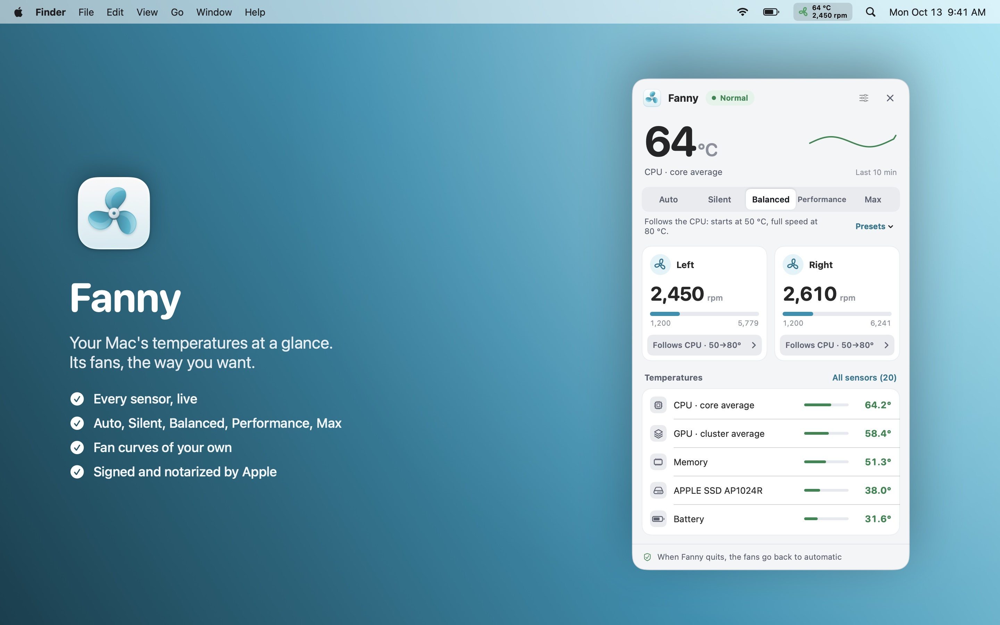
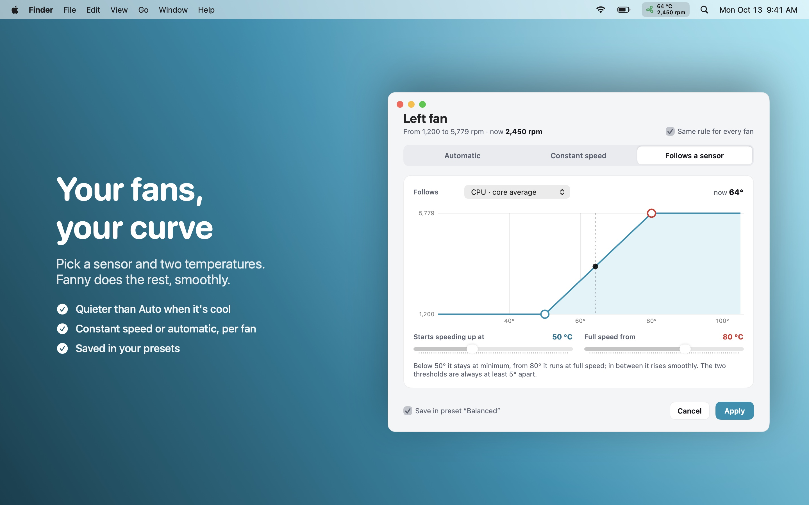
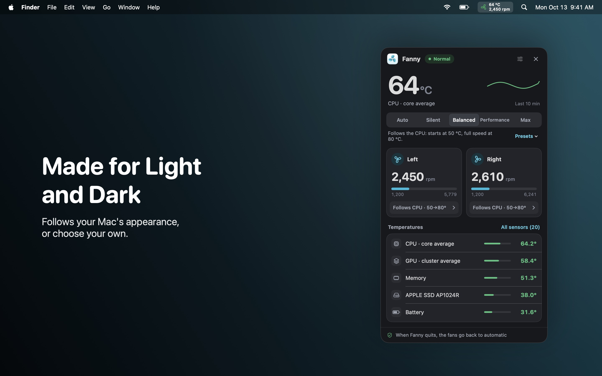
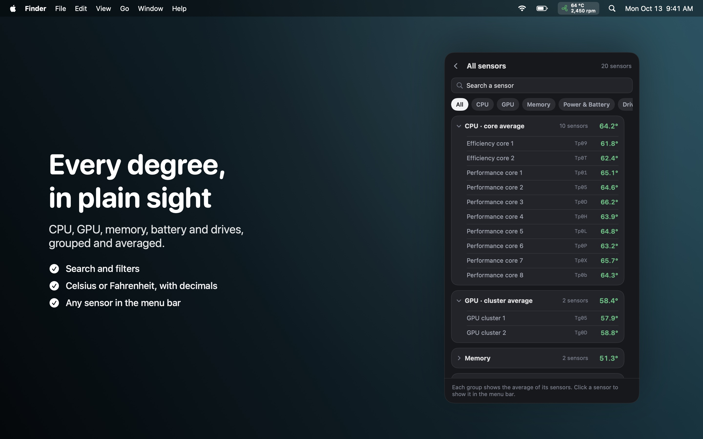
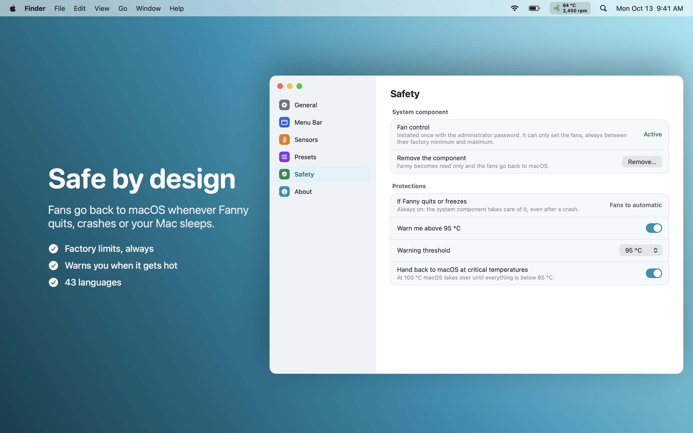

  

<h1 align="center">Fanny</h1>

  Your Mac's temperatures at a glance, and its fans the way you want them. 
  Quieter while you work, more air when it's needed.

  <a href="https://github.com/DevDreamer99/Fanny-Releases/releases/latest"><b>⬇︎ Download the latest version</b></a>
  &nbsp;·&nbsp; macOS 14 Sonoma or later &nbsp;·&nbsp; Apple silicon &amp; Intel &nbsp;·&nbsp; Free

  

---

## What it does

- **Every temperature on your Mac**: CPU cores, GPU, memory, battery, power, SSD and connected drives, grouped and averaged, live.
- **Fan control, three ways** for each fan:
  - **Automatic**: macOS decides, as usual.
  - **Constant speed**: a fixed speed between the fan's own minimum and maximum.
  - **Follows a sensor**: pick a sensor and two temperatures; the fan stays at minimum below the first, runs at full speed from the second and rises smoothly in between.
- **One-click presets**: Auto, Silent, Balanced, Performance, Max, plus your own presets.
- **Quiet by design**: below the start temperature Fanny hands the fan back to macOS, which on Apple silicon can stop it completely, so a quiet preset is never louder than Auto.
- **Menu bar your way**: temperature and/or fan speed, on one line or one above the other, with or without the icon; it can turn red above a temperature you choose.
- **Handy extras**: keyboard shortcuts ⌃⌥1…5 for the presets, an automatic preset on battery, a warning when your Mac runs hot, Fahrenheit, decimals, light and dark themes.
- **43 languages.**

<table>
  <tr>
    <td></td>
    <td></td>
  </tr>
  <tr>
    <td></td>
    <td></td>
  </tr>
</table>

## Install

1. Download the `.dmg` from the [latest release](https://github.com/DevDreamer99/Fanny-Releases/releases/latest).
2. Open it and drag **Fanny** into **Applications**.
3. Open Fanny: it lives in the menu bar, top right.
4. To control the fans, Fanny installs a small system component the first time. macOS asks you to allow it once in **System Settings › General › Login Items** (under "Allow in the Background"), with your administrator password. Without it, Fanny works in monitoring-only mode.

Fanny checks this page once a day and can update itself in a click (you can turn this off in Settings).

## Safe by design

- **Signed with a Developer ID and notarized by Apple.** Updates are installed only if they are signed by the same developer and notarized; anything else is refused.
- **A component that can do very little.** It can only set a fan's speed, always between the fan's factory minimum and maximum, or hand the fans back to macOS. It accepts commands only from Fanny itself (macOS checks the signature) and touches nothing else: no files, no network, no other hardware.
- **Fans are never left stuck.** When Fanny quits, crashes or the Mac goes to sleep, every fan goes back to automatic. At critical temperatures Fanny hands control back to macOS until the Mac cools down.
- **No data collected, no account, no analytics.** The only network request is the daily check of this page for updates.

## Requirements

| | |
|---|---|
| macOS | 14 Sonoma or later |
| Macs | Apple silicon and Intel, with or without fans (fanless Macs get monitoring only) |

## What's new

**1.0.1**
- Temperatures in the preset description no longer break across two lines.
- Settings: the line between the sidebar and the content is drawn correctly.

**1.0.0**
- First release.

---

© 2026 Mattia Fossati

